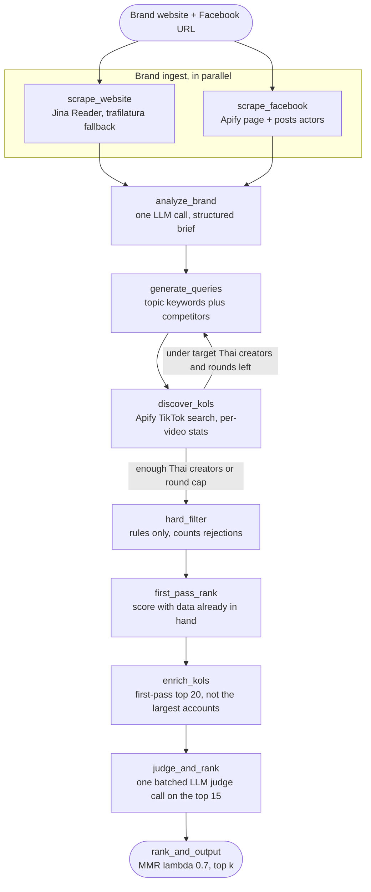
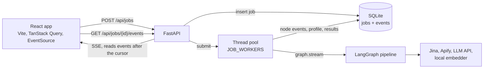

# TikTok KOL Matcher

Give it a brand's website and Facebook page, and it returns a ranked, explained
shortlist of Thai TikTok creators who fit the brand.


KOL Matcher is a LangGraph pipeline behind a FastAPI service and a React web
app. It reads the brand's own pages, has an LLM build a structured brand brief,
searches TikTok for creators, removes accounts that cannot fit, and scores each
survivor on four signals:

| Score | Meaning | How it is computed |
| --- | --- | --- |
| F | Fit | `0.4·sim + 0.3·on_topic + 0.3·judge`, plus a `0.05` mention bonus (F capped at 1). `sim` is the brief-to-caption embedding cosine as a pool percentile, `on_topic` the share of recent videos that name an expanded brief topic term (with a small bio fallback), and `judge` the LLM rubric score. |
| E | Engagement quality | Median per-video `(likes + comments + shares) / views`, shrunk toward the same-tier median (`k = 3`), then ranked within the follower tier. `E = 0.8·ER percentile + 0.2·reach percentile`, where reach is median views divided by followers. |
| T | Tier fit | `exp(−\|log10(followers) − log10(target_followers)\| / σ)` with `σ = 0.5 + 0.5·(1 − tier_confidence)`. |
| A_eff | Audience fit (estimate) | The judge's text-based audience estimate `A`, shrunk toward neutral by its confidence `c`: `A_eff = c·A + (1 − c)·0.5`. Before judging, `A_eff = 0.5`. |

`Final = F × Quality` and `Quality = 0.45·E + 0.30·T + 0.25·A_eff`.

Scoring runs only after hard filters remove the brand's own accounts,
competitor accounts, shop and media accounts, creators who are not Thai,
creators outside 1k–5M followers, and creators whose latest post is over 60
days old.

The API and CLI return F, E, T, A_eff, their confidences, flags, quality, final,
a one-line reason, up to three evidence video links, and the profile URL. The web
app is in Thai and written for marketers: it shows the scores out of 100, marks
low-confidence scores as limited data, and names flags in plain words (see
[GLOSSARY.md](GLOSSARY.md)). The whole pipeline also runs offline in demo mode,
with no keys.

## Contents

- [Screenshots](#screenshots)
- [Quick start](#quick-start)
- [Configuration](#configuration)
- [Architecture](#architecture)
- [Scoring](#scoring)
- [Design decisions and trade-offs](#design-decisions-and-trade-offs)
- [Known limitations](#known-limitations)
- [Testing](#testing)
- [Next steps](#next-steps)
- [Repo layout](#repo-layout)
- [Reference: HTTP API and live integrations](docs/reference.md)

## Screenshots

These come from demo mode, so the brand and every result are sample data.

| Brand form | Progress |
| --- | --- |
|  |  |

The brand profile appears as soon as `analyze_brand` finishes, while discovery
is still running. The web app folds the pipeline stages into five steps; the
API's event stream and the CLI keep the per-node detail.

| Score breakdown | Mobile |
| --- | --- |
|  |  |

The history sheet reopens earlier jobs,
and the job id stays in the URL as `?job=`, so a reload or a shared link opens
the same job.

| Demo results | History |
| --- | --- |
|  |  |

## Quick start

### Docker Compose

```bash
cp .env.example .env   # optional: add keys for live mode
docker compose up --build
```

Open http://localhost:5173. With no `.env`, or no `APIFY_TOKEN` in it, the
service starts in demo mode. Press **ลองดูตัวอย่าง** to fill the form with the
example brand.

Both services bind to `127.0.0.1` only (frontend on 5173, API on 8000), because
the API has no authentication. nginx serves the built app, proxies `/api` to
the backend, and turns off buffering on the event stream. Jobs and caches live
in the `backend-data` volume. The backend runs as a non-root user with a health
check on `/api/health`.

The image skips the local embedding model by default. To include it (this pulls
the CPU build of torch):

```bash
docker build --build-arg INSTALL_EMBED=true -t tkm-backend backend
```

### Local development

You need Python 3.13 with [uv](https://docs.astral.sh/uv/), and Node 24 with
pnpm 11.

`./start.sh` loads `.env` and runs both servers; Ctrl-C stops them. Add `--demo`
to force demo mode. To run them separately:

```bash
# terminal 1: API in demo mode on :8000
cd backend
uv sync                  # add --extra embed for the local embedding model
DEMO_MODE=1 uv run uvicorn app.api.main:app --port 8000

# terminal 2: Vite dev server on :5173, proxies /api to :8000
cd frontend
pnpm install
pnpm dev
```

The API reads its settings from the environment at startup. It does not load
`.env` itself, so export the variables or use Compose. Run it from `backend/`
so `data/jobs.db` lands there, or set `JOBS_DB`.

### CLI

The same graph runs in the foreground from the CLI. With no `--live-*` flag,
every service is mocked and nothing touches the network:

```bash
cd backend
uv run python -m app.cli match \
  --website https://example-brand.co.th \
  --facebook https://www.facebook.com/example-brand \
  --top-k 10
```

Progress goes to stderr and the ranked table to stdout. The table shows F, E,
T, A_eff, their confidences, flags, and the profile URL. It also prints the
rejected counts and the per-stage cost log. `--json` prints one JSON object
instead. Add `--live-web`, `--live-fb`, `--live-kols`, `--live-llm`, or
`--live-embed` to run that service for real. Cost flags:
`--max-results-per-query`, `--max-enrich` (overrides the config's
`enrich_top_n`, default 20), `--min-candidates`, and `--max-rounds`.

## Configuration

### Demo and live mode

`GET /api/health` reports the mode.

- **Demo mode** turns every live flag off, so jobs run on mocks and fixtures
  with no keys. It applies when `DEMO_MODE` is true, or when `DEMO_MODE` is
  unset and `APIFY_TOKEN` is missing.
- **Live mode** applies when `DEMO_MODE` is false, or when it is unset and
  `APIFY_TOKEN` is set. A flag the request omits turns on when it can run. A
  flag set to `true` that cannot run returns 400 and names the missing
  variable, for example `live_kols is unavailable: APIFY_TOKEN is not set`.

Each job stores the flags it actually ran with.

### Environment variables

[`.env.example`](.env.example) lists every variable the code reads. Blank
values take the defaults. Keys and tokens are never logged or put in error
messages, and `/api/health` reports each one only as set or missing.

| Variable | Purpose | Default |
| --- | --- | --- |
| `DEMO_MODE` | `1` forces demo, `0` forces live | unset: live only when `APIFY_TOKEN` is set |
| `APIFY_TOKEN` | Apify, for Facebook, TikTok search, and enrichment | unset |
| `APIFY_JOB_BUDGET_USD` | Estimated Apify budget for one job or CLI run | `1.50` |
| `APIFY_TIKTOK_SEARCH_MAX_CHARGE_USD` | Per-run cap for each TikTok search, at least 0.50 | `0.50` |
| `APIFY_TIKTOK_PROFILE_MAX_CHARGE_USD` | Per-run cap for each profile enrichment, at least 0.50 | `0.50` |
| `APIFY_FACEBOOK_MAX_CHARGE_USD` | Per-run cap for each Facebook page or posts run | `0.50` |
| `APIFY_ENRICH_RESERVE_USD` | Budget TikTok search must leave for enrichment, below the job budget | `0.70` |
| `TIKTOK_RESULTS_PER_QUERY` | Videos per TikTok search query, 1-50 | `15` |
| `TIKTOK_PROFILE_VIDEOS` | Recent videos fetched per enriched profile, 1-30 | `10` |
| `DISCOVERY_MIN_THAI_CANDIDATES` | Thai creators discovery aims for before it stops | `30` |
| `DISCOVERY_MAX_ROUNDS` | Most query and search rounds, 1-5 | `3` |
| `JINA_API_KEY` | Optional Jina Reader key for a higher rate limit | unset |
| `WEB_FETCH_ALLOW_PROXY_RANGE` | Allow the direct web fetch guard to reach exactly 198.18.0.0/15 (fake-IP proxy range for some sandboxes; weakens the private-address guard) | off |
| `LLM_BASE_URL` | OpenAI-compatible API root | `https://integrate.api.nvidia.com/v1` |
| `LLM_MODEL` | Chat model id | `nvidia/nemotron-3.5-lightning-30b-a3b` |
| `LLM_API_KEY`, `NVIDIA_API_KEY`, `OPENAI_API_KEY` | LLM bearer token, first non-empty wins | unset |
| `LLM_TIMEOUT`, `LLM_MAX_TOKENS`, `LLM_TEMPERATURE` | Request limits (timeout is per attempt) | `60`, `4096`, `0.2` |
| `LLM_MAX_RETRIES`, `LLM_RETRY_BACKOFF` | Retries for timeouts, connection errors, 408, 429, and 5xx, with doubling backoff | `2`, `2` |
| `LLM_DISABLE_REASONING`, `LLM_NO_THINK_MESSAGE` | How to turn model thinking off | `extra_body` for the default model only |
| `EMBED_MODEL` | Local sentence-transformers model | `google/embeddinggemma-2` |
| `EMBED_DEVICE`, `EMBED_DIM`, `EMBED_DTYPE`, `EMBED_BATCH_SIZE` | Embedder settings | `cpu`, `768`, `float32`, `32` |
| `HF_TOKEN` | Hugging Face token, only for a gated model | unset |
| `KOL_CACHE_DIR` | Cache root for web, Facebook, profile enrichment, and embeddings; TikTok search is not cached | `data/cache` at the repo root |
| `JOBS_DB` | SQLite job store | `data/jobs.db` |
| `CORS_ORIGINS` | Allowed browser origins, comma-separated | `http://localhost:5173` |
| `JOB_WORKERS` | Jobs that run at once | `2` |
| `MAX_QUEUED_JOBS` | Queued or running jobs before `POST /api/jobs` returns 429 | `20` |

The last five must be unset, not blank, to take their defaults. An invalid
Apify or discovery value, such as a TikTok cap below 0.50 or a non-numeric
budget, makes `POST /api/jobs` return 400 naming the variable, and makes the
CLI exit with code 2, before any Apify run starts. `--max-results-per-query`,
`--min-candidates`, and `--max-rounds` override the matching variables for one
CLI run. `--max-enrich` is optional and overrides
`MatchingConfig.enrich_top_n` (default 20).

## Architecture

### Pipeline

The graph lives in `backend/app/graph.py` and the nodes in
`backend/app/nodes.py`.



1. **Brand ingest.** The website and Facebook nodes run in the same
   superstep. Either source is enough: brand analysis runs when at least one of
   the website text or the Facebook page is available, and fails only when both
   are missing. A missing source is a warning that names the failed scrape.
2. **Structured brief.** One LLM call returns category, key products, price
   tier, target audience, tone, Thai and English topic keywords, competitors,
   `brand_handles`, and a tier guess: `target_followers`, `tier_label`,
   `tier_confidence`, and `tier_reason`. The tier guess maps an SME or small
   online shop to micro (~30k), a nationwide brand to mid (~150k), and a
   multinational to macro (~800k), and clamps `target_followers` to the
   10k–2M range. `tidy_brand_profile` then cleans the lists, and the output
   shows `tier_label` and `tier_reason`.
3. **Discovery loop.** Query generation and TikTok search repeat until 30
   unique creators that pass the Thai filter are found, or three rounds have
   run. Each round asks for 6-10 new queries built from topic keywords and
   competitors, never the brand name. Each query is one paid Apify run and
   returns up to 15 videos. Creators are deduped, and every video's views,
   likes, comments, shares, date, caption, and URL are kept.
4. **Hard filters.** Free rules drop the brand's own accounts, competitor
   accounts, shop and media accounts, creators who are not Thai, creators
   outside 1k–5M followers, and creators whose latest post is over 60 days
   old. The activity rule waits until after enrichment, because a search hit
   is not a creator's newest video; every rule then runs again on the
   enriched profiles. Each rejection is counted by reason for the CLI and API
   output.
5. **First-pass rank.** Every survivor is scored with data already in hand:
   embedding similarity, on-topic share, and search-derived engagement. The
   judge has not run yet, so `judge = sim percentile` and `A_eff = 0.5`. The
   result decides which creators are worth paying to enrich.
6. **Enrichment.** Fetches recent videos for the first-pass leaders, the top
   20 in that ranking rather than the largest accounts. At the estimated rates,
   the `$0.70` reserve and the job budget allow 20 profile runs, matching
   `MatchingConfig.enrich_top_n`. Leaders beyond that keep their search-derived
   stats, get lower engagement confidence, and carry the `search_stats_only`
   flag.
7. **Judge.** The top 15 go to one batched LLM call. It returns `judge`, `A`,
   and a confidence `c` per creator. Creators the reply leaves out are asked
   for once more; any still missing are reported and ranked unjudged, with
   `judge` capped at a neutral 0.5 so they cannot pass the judged leaders on
   similarity alone. The rubric checks category match, tone
   match, and no risky content. Audience is estimated from text, captions, and
   bio only, never from faces. Risky content becomes a flag.
8. **Output.** Every candidate is scored again now that judged values exist.
   The top k is selected with MMR over `Final`, using caption similarity, so
   near-duplicate creators do not fill the list. Each row carries the scores,
   confidences, flags, `tier_reason`, reason, up to three evidence video links,
   and the profile URL.

A fatal node error sets `stage` to `failed` and ends the graph. A partial
failure, such as one profile that fails to enrich, is recorded in `errors` and
the run continues.

### Service



`POST /api/jobs` validates the request, stores the job, and hands it to a
thread pool. The worker streams the graph and writes a `started` and a
`finished` or `failed` event for each node, and saves the brand profile as soon
as it exists. The SSE endpoint reads stored events after the client's cursor
(`Last-Event-ID` or `?after=`), so a live stream, a reconnect, and a replay of
a finished job all use the same code. Jobs left running by a previous process
are marked failed on startup.

Every external service in `backend/app/integrations/` is a `Protocol` with a
mock and a live implementation, selected per job by the live flags. Web pages,
Facebook pages, profile enrichment, and embedding vectors are cached on disk.
TikTok search is not cached: every query is a paid Apify run, so a repeated run
still pays for search.

## Scoring

Every score is in `[0, 1]` except the MMR term. The functions live in
`backend/app/scoring.py`, the selection in `backend/app/ranking.py`, and every
tuning value in `backend/app/matching_config.py` (`MatchingConfig`).

```text
F       = 0.4·sim + 0.3·on_topic + 0.3·judge (+0.05 mention bonus, cap 1)
E       = 0.8·percentile_in_tier(ER*) + 0.2·percentile_in_tier(reach)
T       = exp(−|log10(followers) − log10(target_followers)| / σ)
σ       = 0.5 + 0.5·(1 − tier_confidence)
A_eff   = c·A + (1 − c)·0.5
Quality = 0.45·E + 0.30·T + 0.25·A_eff
Final   = F × Quality
MMR     = argmax λ·Final − (1 − λ)·max_similarity_to_selected, λ = 0.7
```

**F — fit.** `sim` is the cosine between the brief and the creator's recent
captions, converted to a percentile within the candidate pool. `on_topic` is
the share of up to 10 recent videos whose caption or hashtags contains a brief
topic term. Brief terms are widened offline with the built-in category lexicon
in `backend/app/topic_lexicon.py`: when the brief's category, products, or
topic keywords mention a common category (skincare/beauty, makeup, haircare,
food, beverage, fashion, fitness, tech/gadget, home, baby/mom, pet, travel, or
finance), matching Thai and English terms for that category are added. A
matching creator bio supplies partial credit, so `on_topic = max(video share,
cfg.on_topic_bio_floor)`; the floor is `0.3` by default.
`judge` is the LLM rubric score. Before the judge stage, `judge` is the `sim`
percentile, so the first pass and the final pass use the same formula.

**E — engagement quality.** For each recent video, `ER = (likes + comments +
shares) / views`, skipping videos with zero views. The median over the videos
is shrunk toward the median ER of the same follower tier:
`ER* = (n·median + k·prior_tier) / (n + k)` with `k = 3`, falling back to the
global pool median when a tier is empty. `ER*` is then ranked within the tier,
because engagement naturally falls as followers grow. The second term is reach,
`median views / followers`, also ranked within the tier; a creator with no
views or followers gets the neutral `0.5`. Engagement confidence is
`n/(n+3)` times `0.6` for search-derived stats or `1.0` for profile stats.
Search results skew viral, so a creator seen only in search is trusted less.

**T — tier fit.** A creator exactly at `target_followers` scores 1. The
distance is measured in log10 followers, and `σ` widens when the brief's tier
guess is unsure.

**A_eff — audience fit.** The judge returns `A` and a confidence `c`, and
`A_eff` shrinks the estimate toward `0.5` when `c` is low. This is an
estimate, not measured demographics.

**Quality and Final.** Quality is a weighted blend of the three non-fit
signals, and Final multiplies it by F.

**Diversity.** The top k is chosen greedily with MMR. The first pick has the
highest `Final`; each later pick maximizes `0.7·Final − 0.3·max similarity to
an already selected creator`. The aim is a mix of tiers and styles rather than
near-duplicates.

### Why these choices

**Why F is multiplicative.** A creator with excellent engagement but the wrong
niche should not outrank an on-niche creator with average engagement. Making F
a multiplier means the fit score acts as a gate on Quality; an off-niche
creator can only rank on engagement if F is not near zero. The tests include
that case.

**Why A is an estimate.** TikTok does not expose audience demographics to
scrapers, so there is no measured age or gender split to use. The judge reads
the creator's text, captions, and bio and returns a guess plus a confidence.
`A_eff` shrinks a low-confidence guess toward neutral instead of pretending it
is precise. Age and gender are never inferred from faces, both for ethics and
for PDPA reasons.

**Why a mention bonus instead of a cap.** A creator who names the brand or a
competitor in their recent text gets `+0.05` on F, capped at 1. Creators who
have never mentioned the brand are not penalized; most good creators for a new
campaign have not. Recent competitor sponsorship is only a flag
(`competitor_sponsored`), not a score penalty.

**How the tier is guessed.** The brief prompt asks the model to use price tier,
sales channels, local versus multinational reach, and the brand page's follower
count. An SME or small online shop maps to micro (~30k), a nationwide Thai
brand to mid (~150k), and a multinational to macro (~800k). The result is
clamped to 10k–2M and shown with `tier_label`, `tier_confidence`, and
`tier_reason`.

**Judge before stage 6.** Until the batched judge call runs, `judge = sim` and
`A_eff = 0.5`. That keeps first-pass ranking cheap and confirmatory: it only
decides which 20 candidates deserve profile enrichment. The judge then changes
F for the top 15, and the final ranking is recomputed for everyone.

**Every tuning value lives in `MatchingConfig`.** The score weighting, shrinkage `k`,
reach blend, tier bounds, stage sizes, MMR lambda, and confidence values are
frozen dataclass fields, validated at construction, instead of numbers spread
through the code.

**The eval harness.** [`eval/README.md`](eval/README.md) documents an offline
NDCG@10 harness over cached candidate pools, with `--ablate F|E|T|A`. It needs
no network. The labels in `eval/golden/` are drafts, not human-checked. On the
example pool, ablating A raises mean NDCG@10 from 0.9113 to 0.9558, so the
current A term is not yet justified by that set. The harness is the tool for
tuning once real labels exist.

### Cost per job

`estimate_run_cost` in `backend/app/integrations/apify.py` charges `$0.005`
per run plus a per-item rate, and caps the result at the run's own
`maxTotalChargeUsd`. The rates are TikTok search `$0.004`, profile enrichment
`$0.003`, Facebook page `$0.015`, and Facebook posts `$0.005` per item. The
sync endpoint returns dataset items but not usage, so these are estimates.

| Step | Estimate |
| --- | --- |
| Facebook page, 1 item | `0.005 + 0.015` = $0.020 |
| Facebook posts, 20 items | `0.005 + 20 × 0.005` = $0.105 |
| Facebook subtotal | $0.125 |
| TikTok search, 15 videos per query | `0.005 + 15 × 0.004` = $0.065 per run |
| Search runs | 10 runs = $0.65 |
| Profile enrichment, 10 videos per profile | `0.005 + 10 × 0.003` = $0.035 per run |
| Profile runs | 20 runs = $0.70 |
| **Total at the conservative estimate** | **$1.475 of $1.50** |

`MatchingConfig.max_search_queries` caps search at 10 queries per job, so an
eleventh search run is not allowed. Raising `--max-enrich` above 20 would
need `$1.475 + $0.035 = $1.51` for a 21st profile, over the `$1.50` budget, so
the budget guard would skip it. `estimate_default_job_usd` reproduces this table.

These are estimates from the code's own per-item rates; the `$1.50` default has
not been verified with a live v2 run.

The reserve matters for enrichment. The `$0.70` reserve guarantees room for 20
profile runs, which equals `MatchingConfig.enrich_top_n` (default 20), so every
first-pass leader the config asks for gets profile stats. Leaders outside the
top 20 keep stats from their search videos, score E with lower confidence, and
carry `search_stats_only`. They are not dropped.

LLM calls per job are one brand brief, one per query round (usually two or
three), and one judge call: four or five calls in total. The CLI prints a cost
log with one line per stage, for example:

```text
cost log:
  llm: analyze_brand 1 call
  llm: generate_queries round 1 1 call
  search round 1: est $0.52 (8 queries)
  llm: generate_queries round 2 1 call
  search round 2: est $0.13 (2 queries)
  enrich: est $0.70 (20 profiles)
  llm: judge 1 call (15 creators)
```

## Design decisions and trade-offs

**An OpenAI-compatible LLM, chosen by configuration.** The live client speaks
the chat completions API, so moving from the default NVIDIA-hosted Nemotron
model to OpenAI or a local server means changing `LLM_BASE_URL`, `LLM_MODEL`,
and the key. Every call asks for one JSON object, validates it with Pydantic,
and retries once with the validation error in the prompt. The default model is
a reasoning model, so thinking is turned off through `chat_template_kwargs`.
That cut a brand-analysis call from 30-45 seconds to about 3.

**Local embeddings as a free similarity term.** embeddinggemma runs on CPU
through sentence-transformers, with no per-call cost and no data leaving the
machine. It supplies `sim` for F and the document similarity that MMR uses.
The trade-off is a heavy optional dependency (torch), so it sits behind the
`embed` extra and the default install and tests stay light.

**One judge, not one call per creator.** Only the top 15 see the LLM judge, and
they share one request. That keeps the expensive stage small and makes the
rubric consistent across candidates.

**An estimated Apify budget plus per-run caps.** Every Apify run sets
`maxItems`, `limit`, and `maxTotalChargeUsd`. The TikTok actors reject a cap
below $0.50, so the TikTok caps default to that minimum and a lower value is
rejected with an error before any run starts. On top of that,
`APIFY_JOB_BUDGET_USD` (default $1.50) covers the whole job. A run starts only
if its worst-case estimate, from the item count it asks for, still fits in the
budget. Runs that do not fit are skipped and recorded as warnings, and the job
still finishes with what it has. The cost table is in
[Cost per job](#cost-per-job).

**A reserve so search cannot starve enrichment.** A search run starts only if
the estimated spend, plus that run, plus `APIFY_ENRICH_RESERVE_USD` ($0.70)
fits in the budget, so profile runs always have room. With the defaults this
means at most 10 search runs (the query cap) and 20 profile runs, matching
`MatchingConfig.enrich_top_n`.

**SSE instead of polling from the browser.** Progress is a one-way stream of
small events, which is what server-sent events are for. `EventSource`
reconnects and resends `Last-Event-ID` on its own. Inside the server the stream
reads SQLite every 0.25 seconds, which keeps replay and live delivery on one
code path at the cost of a little latency. Before reconnecting, the frontend
checks that the job still exists, so a stale `?job=` link stops instead of
retrying forever.

**SQLite for jobs and events.** One file, no extra service, and it survives a
restart in the Compose volume. It fits a single-node tool with a few jobs at a
time. Several API replicas would need a shared database and a real queue.

**Demo mode by default.** Without an `APIFY_TOKEN`, the service runs the full
graph on fixtures, so anyone can clone the repo and see the product in a minute
without spending money. The fixtures cover the awkward cases: duplicate handles
with different casing, non-Thai creators, the brand's own account, shop and
media accounts, and a second discovery round.

**Guarding a public-URL fetcher.** The API only accepts Facebook URLs on
facebook.com or fb.com, rejects website URLs on local or private addresses,
and the web reader checks resolved addresses before a direct fetch.

## Known limitations

- **The tuning values are not fitted.** The score weighting, the shrinkage constant,
  and the MMR lambda are reasoned starting points. The eval labels are drafts,
  and on the example pool ablating A does not lower NDCG@10, so that term is
  not yet supported by evidence.
- **Shop and media detection can misfire.** It matches tokens such as `shop`,
  `store`, `official`, `news`, `media`, and `tv` inside handle segments and the
  nickname, so a legitimate creator with `official` or `tv` in the name can be
  dropped.
- **`on_topic` is keyword-based.** Terms are expanded from a small built-in
  category lexicon with a bio fallback, but a relevant video described in
  unseen words can still be missed, and a passing mention still counts as a
  hit. Adding a new niche means adding its terms to `topic_lexicon.py`.
- **The Apify budget is an estimate.** It is computed from item counts and
  per-item rates measured on this account, not from Apify's billing. If Apify's
  prices rise, real spend can pass the budget until the rates are updated.
- **The live budget caps enrichment.** The 20-profile default fits only at the
  estimated rates. If real prices are higher, the guard skips the last
  profiles, and they keep `search_stats_only` stats. This has not been verified
  on a live v2 run.
- **TikTok search is not cached.** Web pages, Facebook pages, profile
  enrichment, and embeddings are cached, but every search query is a paid run.
  Repeating a job without changing the brand still pays for search.
- **No warning when the budget skips the Facebook run.** If the budget stops a
  Facebook run, the reader quietly falls back to the web reader, or keeps the
  page without posts, and the job shows no warning about it.
- **The Facebook web fallback can accept a login wall.** When it reads the page
  through Jina, it does not detect Facebook's login page, so the brand profile
  may get login text instead of the page's "about".
- **The candidate pool is measured on one brand.** Three live runs on the same
  retail brand, all before matching v2. The run in the screenshots used the
  first settings (10 videos per query, a language-and-region filter, a loop
  that counted every creator); it found 48 creators and kept 12. A run with 20
  videos per query and the Thai-script filter found 210 and kept 60 after two
  rounds, and spent $0.93 of real Apify credit. A run with 15 videos per query,
  recalibrated estimates, and LLM retries found 138 creators in two rounds and
  kept 33. It took 10 min 14 s and spent $0.78 of real Apify credit: 10 search
  runs and 7 profile runs. One profile run timed out and the budget skipped 2
  more, so at most 6 creators got profile stats. No live run has used matching
  v2, so the current recall, runtime, and spend are unmeasured.
- **The brand mention check is literal.** A creator who refers to the brand
  only in speech, an image, or an unlisted nickname does not get the bonus, and
  an alias the LLM misses is not matched.
- **The Thai filter is a heuristic.** A Thai creator with English-only text and
  no TH region is missed, and a non-Thai account that writes in Thai is kept.
- **Audience fit is an estimate.** It comes from the judge reading text, not
  from audience demographics, which TikTok does not expose to scrapers. It is
  never inferred from faces.
- **The API has no authentication.** It is built for local use and binds to
  localhost in Compose.

## Testing

```bash
cd backend && uv run pytest          # 384 tests
cd backend && uv run python ../eval/run_eval.py   # NDCG@10, no network
cd frontend && pnpm lint && pnpm test   # ESLint, Prettier, 41 Vitest tests
```

The tests make no network calls. The backend suite covers the graph routing and
fail-fast behaviour, every live integration against mocked HTTP (Jina and
captcha replies, Apify errors and budgets, LLM JSON repair and retries, and
the embedder), the API and SSE resume, brand-profile cleanup, the new scores,
the hard filters, and MMR. The frontend suite covers the step reducer, the SSE
follower's retry and stop rules, the job-progress hook, the API client,
formatting, the CSV export, and the app flow.

`backend/scripts/` has small live smoke checks for Apify, the LLM, and the
embedder. They need real keys, and the Apify one spends credit.

## Next steps

1. **Human labels and tuning.** Replace the draft eval labels with a marketer's
   labels for a few brands, then use [`eval/README.md`](eval/README.md) to
   tune the scoring values and confirm that each term earns its place.
2. **A live run with matching v2.** Measure recall, runtime, enriched profiles,
   and spend on the current pipeline; the current figures predate it.
3. **More enrichment within budget.** Raise the profile cap only when the
   estimated spend allows it, and measure whether profile stats change the top
   10 enough to justify the cost.
4. **Better signals.** Add comment language as a weak audience signal, detect
   the Facebook login wall, and warn when the budget skips a Facebook run.
5. **Real spend tracking.** Read `usageTotalUsd` from Apify's run API after each
   run instead of estimating.
6. **CI.** Run the backend and frontend suites and the Docker build on every
   pull request.
7. **Production shape.** Authentication, a shared database, and a job queue if
   it ever needs more than one node.

## Repo layout

```text
backend/
  app/
    graph.py          # graph wiring, parallel fan-in, discovery loop
    nodes.py          # the pipeline nodes
    matching_config.py # every tuning value for matching v2
    filters.py        # free hard filters and rejection reasons
    scoring.py        # F, E, T, A_eff, Quality, Final, flags, MMR helper
    ranking.py        # first pass, judge pass, RankedKol, MMR selection
    models.py         # MatchRequest, BrandProfile, KolProfile, RankedKol
    brand_tidy.py     # cleanup of the LLM brand profile
    prompts.py        # prompts for the brief, queries, and judge
    cli.py            # CLI (table or JSON)
    api/              # FastAPI app, settings, SQLite store, job runner
    integrations/     # Protocol + mock + live client per service, with caches
    fixtures/         # demo website, Facebook page, creators, Apify samples
  scripts/            # live smoke checks
  tests/
eval/                 # offline NDCG@10 harness, golden labels, cached pools
frontend/
  src/
    api/              # wire types, fetch client, query hooks, SSE follower
    components/       # form, progress, brand profile, results, history
    hooks/ lib/       # job progress, URL state, step reducer, CSV, validation
    styles/tokens.css # design tokens
  Dockerfile          # pnpm build, then nginx
  nginx.conf          # static files, /api proxy, unbuffered event stream
docs/
  reference.md        # HTTP API and live integration details
  screenshots/
docker-compose.yml
.env.example
```
