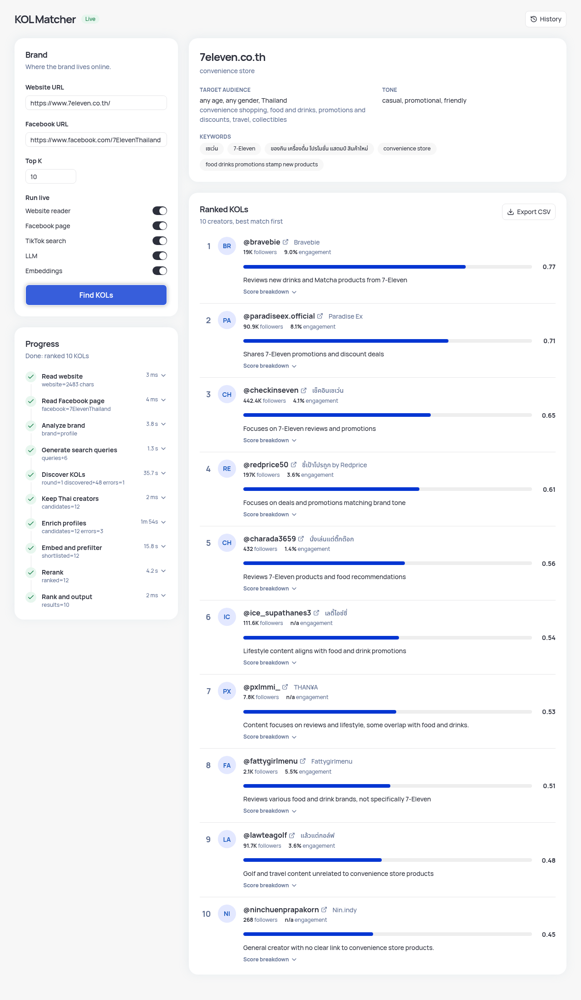
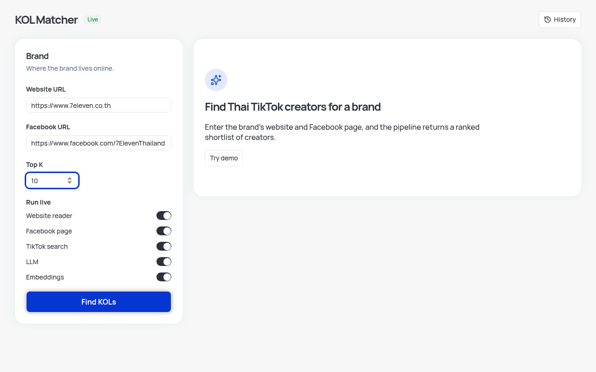
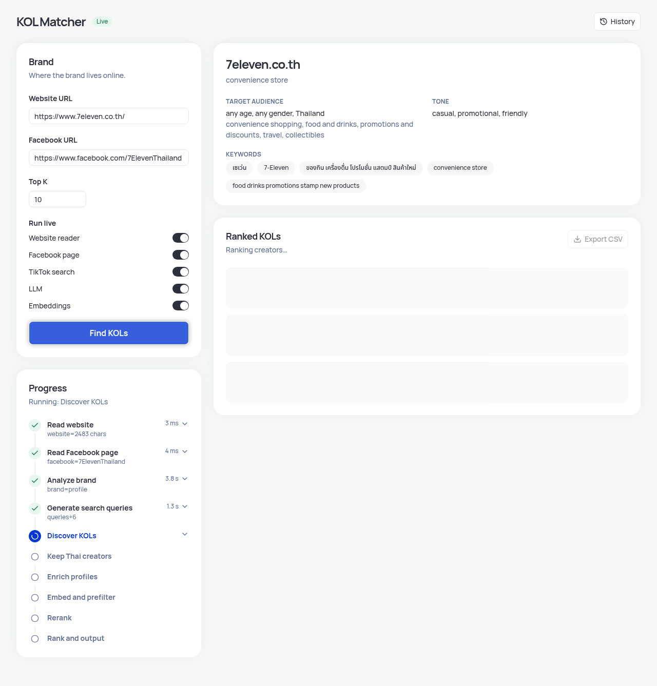
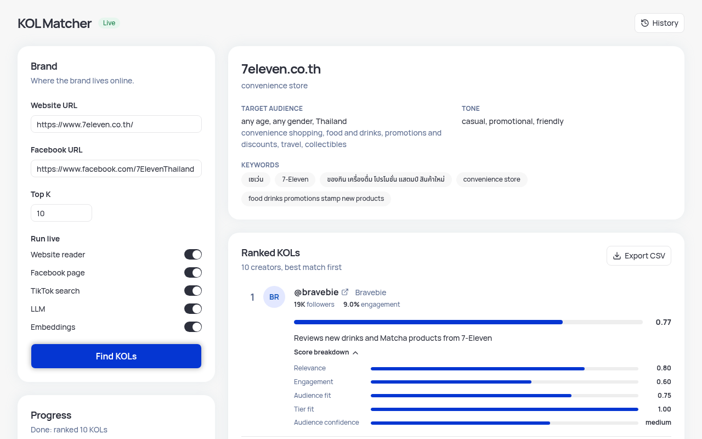
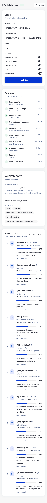
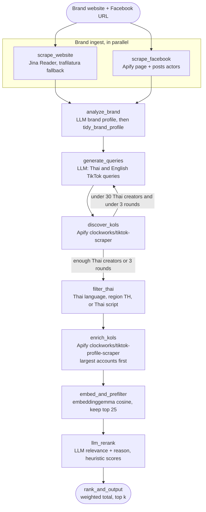
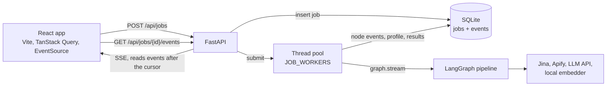

# TikTok KOL Matcher

Give it a brand's website and Facebook page, and it returns a ranked, explained
shortlist of Thai TikTok creators who fit the brand.



KOL Matcher is a LangGraph pipeline behind a FastAPI service and a React web
app. It reads the brand's own pages, has an LLM build a structured brand
profile, searches TikTok for creators, keeps the Thai ones, and scores each
creator on four signals:

| Signal | Weight | How it is scored |
| --- | --- | --- |
| Relevance | 40% | LLM rerank of each creator against the brand profile, with the embedding cosine as a hint |
| Engagement | 25% | Median `(likes + comments + shares) / views` over recent videos |
| Audience fit | 20% | Thai language and Thailand region signals |
| Follower tier | 15% | nano, micro, macro, or mega against the tiers the brand profile prefers |

Every result shows its component scores, the weighted total, and a one-line
reason. The whole pipeline also runs offline in demo mode, with no keys.

## Contents

- [Screenshots](#screenshots)
- [Quick start](#quick-start)
- [Configuration](#configuration)
- [Architecture](#architecture)
- [Design decisions and trade-offs](#design-decisions-and-trade-offs)
- [Known limitations](#known-limitations)
- [Testing](#testing)
- [Next steps](#next-steps)
- [Repo layout](#repo-layout)
- [Reference: HTTP API and live integrations](docs/reference.md)

## Screenshots

These come from one live run with every integration on (website, Facebook,
TikTok search, LLM, and embeddings). The brand URL is only sample input. The
run took about three minutes for a top 10.

| Brand form | Live progress |
| --- | --- |
|  |  |

The brand profile appears as soon as `analyze_brand` finishes, while discovery
is still running. Each step shows its duration and a short summary such as
`queries+6` or `candidates=12`.

| Score breakdown | Mobile |
| --- | --- |
|  |  |

Demo mode runs the same UI on fixtures. The history sheet reopens earlier jobs,
and the job id stays in the URL as `?job=`, so a reload or a shared link opens
the same job.

| Demo results | History |
| --- | --- |
|  |  |

## Quick start

### Docker Compose

```bash
cp .env.example .env   # optional: add keys for live mode
docker compose up --build
```

Open http://localhost:5173. With no `.env`, or no `APIFY_TOKEN` in it, the
service starts in demo mode. Press **Try demo** to fill the form with the
example brand.

Both services bind to `127.0.0.1` only (frontend on 5173, API on 8000), because
the API has no authentication. nginx serves the built app, proxies `/api` to
the backend, and turns off buffering on the event stream. Jobs and caches live
in the `backend-data` volume. The backend runs as a non-root user with a health
check on `/api/health`.

The image skips the local embedding model by default. To include it (this pulls
the CPU build of torch):

```bash
docker build --build-arg INSTALL_EMBED=true -t tkm-backend backend
```

### Local development

You need Python 3.13 with [uv](https://docs.astral.sh/uv/), and Node 24 with
pnpm 11.

```bash
# terminal 1: API in demo mode on :8000
cd backend
uv sync                  # add --extra embed for the local embedding model
DEMO_MODE=1 uv run uvicorn app.api.main:app --port 8000

# terminal 2: Vite dev server on :5173, proxies /api to :8000
cd frontend
pnpm install
pnpm dev
```

The API reads its settings from the environment at startup. It does not load
`.env` itself, so export the variables or use Compose. Run it from `backend/`
so `data/jobs.db` lands there, or set `JOBS_DB`.

### CLI

The same graph runs in the foreground from the CLI. With no `--live-*` flag,
every service is mocked and nothing touches the network:

```bash
cd backend
uv run python -m app.cli match \
  --website https://example-brand.co.th \
  --facebook https://www.facebook.com/example-brand \
  --top-k 10
```

Progress goes to stderr and the ranked table to stdout. `--json` prints one
JSON object instead. Add `--live-web`, `--live-fb`, `--live-kols`,
`--live-llm`, or `--live-embed` to run that service for real. Cost flags:
`--max-results-per-query`, `--max-enrich`, `--min-candidates`, `--max-rounds`,
and `--prefilter-limit`.

## Configuration

### Demo and live mode

`GET /api/health` reports the mode.

- **Demo mode** turns every live flag off, so jobs run on mocks and fixtures
  with no keys. It applies when `DEMO_MODE` is true, or when `DEMO_MODE` is
  unset and `APIFY_TOKEN` is missing.
- **Live mode** applies when `DEMO_MODE` is false, or when it is unset and
  `APIFY_TOKEN` is set. A flag the request omits turns on when it can run. A
  flag set to `true` that cannot run returns 400 and names the missing
  variable, for example `live_kols is unavailable: APIFY_TOKEN is not set`.

Each job stores the flags it actually ran with.

### Environment variables

[`.env.example`](.env.example) lists every variable the code reads. Blank
values take the defaults. Keys and tokens are never logged or put in error
messages, and `/api/health` reports each one only as set or missing.

| Variable | Purpose | Default |
| --- | --- | --- |
| `DEMO_MODE` | `1` forces demo, `0` forces live | unset: live only when `APIFY_TOKEN` is set |
| `APIFY_TOKEN` | Apify, for Facebook, TikTok search, and enrichment | unset |
| `APIFY_JOB_BUDGET_USD` | Estimated Apify budget for one job or CLI run | `1.00` |
| `APIFY_TIKTOK_SEARCH_MAX_CHARGE_USD` | Per-run cap for each TikTok search, at least 0.50 | `0.50` |
| `APIFY_TIKTOK_PROFILE_MAX_CHARGE_USD` | Per-run cap for each profile enrichment, at least 0.50 | `0.50` |
| `APIFY_FACEBOOK_MAX_CHARGE_USD` | Per-run cap for each Facebook page or posts run | `0.50` |
| `APIFY_ENRICH_RESERVE_USD` | Budget TikTok search must leave for enrichment, below the job budget | `0.35` |
| `TIKTOK_RESULTS_PER_QUERY` | Videos per TikTok search query, 1-50 | `15` |
| `TIKTOK_PROFILE_VIDEOS` | Recent videos fetched per enriched profile, 1-30 | `10` |
| `DISCOVERY_MIN_THAI_CANDIDATES` | Thai creators discovery aims for before it stops | `30` |
| `DISCOVERY_MAX_ROUNDS` | Most query and search rounds, 1-5 | `3` |
| `JINA_API_KEY` | Optional Jina Reader key for a higher rate limit | unset |
| `LLM_BASE_URL` | OpenAI-compatible API root | `https://integrate.api.nvidia.com/v1` |
| `LLM_MODEL` | Chat model id | `nvidia/nemotron-3.5-lightning-30b-a3b` |
| `LLM_API_KEY`, `NVIDIA_API_KEY`, `OPENAI_API_KEY` | LLM bearer token, first non-empty wins | unset |
| `LLM_TIMEOUT`, `LLM_MAX_TOKENS`, `LLM_TEMPERATURE` | Request limits (timeout is per attempt) | `60`, `4096`, `0.2` |
| `LLM_MAX_RETRIES`, `LLM_RETRY_BACKOFF` | Retries for timeouts, connection errors, 408, 429, and 5xx, with doubling backoff | `2`, `2` |
| `LLM_RERANK_BATCH_SIZE` | Creators per rerank request | `5` |
| `LLM_DISABLE_REASONING`, `LLM_NO_THINK_MESSAGE` | How to turn model thinking off | `extra_body` for the default model only |
| `EMBED_MODEL` | Local sentence-transformers model | `google/embeddinggemma-2` |
| `EMBED_DEVICE`, `EMBED_DIM`, `EMBED_DTYPE`, `EMBED_BATCH_SIZE` | Embedder settings | `cpu`, `768`, `float32`, `32` |
| `HF_TOKEN` | Hugging Face token, only for a gated model | unset |
| `PREFILTER_LIMIT` | CLI only: creators kept by the embedding prefilter | `25` |
| `KOL_CACHE_DIR` | Cache root for web, Facebook, Apify, and embeddings | `data/cache` at the repo root |
| `JOBS_DB` | SQLite job store | `data/jobs.db` |
| `CORS_ORIGINS` | Allowed browser origins, comma-separated | `http://localhost:5173` |
| `JOB_WORKERS` | Jobs that run at once | `2` |
| `MAX_QUEUED_JOBS` | Queued or running jobs before `POST /api/jobs` returns 429 | `20` |

The last five must be unset, not blank, to take their defaults. An invalid
Apify or discovery value, such as a TikTok cap below 0.50 or a non-numeric
budget, makes `POST /api/jobs` return 400 naming the variable, and makes the
CLI exit with code 2, before any Apify run starts. `--max-results-per-query`,
`--min-candidates`, and `--max-rounds` override the matching variables for one
CLI run.

## Architecture

### Pipeline

The graph lives in `backend/app/graph.py` and the nodes in
`backend/app/nodes.py`.



1. **Brand ingest.** The website and Facebook nodes run in the same
   superstep. The website is required. A missing Facebook page is only a
   warning, and brand analysis runs on the website alone.
2. **Brand profile.** The LLM returns category, products, target audience,
   tone, content style, Thai and English keywords, hashtags, and preferred
   tiers as JSON, validated with Pydantic. The website and the Facebook
   "about" text are the main evidence. At most the three newest posts, cut to
   200 characters each, go in as weak signals for tone. `tidy_brand_profile`
   then drops sentence-like keywords, caps list lengths, and fixes age bounds.
3. **Discovery loop.** Query generation and TikTok search repeat until 30
   unique creators that pass the Thai filter are found, or three rounds have
   run. Each round asks the LLM only for 6-10 queries it has not tried yet, and
   each query returns up to 15 videos. Videos are deduped by author, and up to
   three captions per author are kept.
4. **Thai filter.** Keeps a creator when the video language is Thai, the
   account region is Thailand, or the nickname, bio, or search captions contain
   Thai script (at least two Thai characters, so one stray character does not
   count). An English-only creator outside Thailand is still dropped.
5. **Enrichment.** Fetches recent videos for the largest accounts (10 by
   default), then computes the median engagement rate and posts per week.
6. **Prefilter.** Embeds the brand text and every creator's bio, captions, and
   hashtags with a local model, and keeps the closest 25 (or `top_k` if that is
   larger) by cosine similarity.
7. **Rerank.** The LLM scores relevance from 0 to 1 with a short reason, in
   batches of 5. Each creator card says whether the creator's nickname, bio, or
   captions name the brand (`mentions_brand`), and the prompt forbids crediting
   another store's campaign to the brand. After the model replies, a creator who
   never names the brand has relevance capped at 0.6 and the reason says so.
   Engagement, audience fit, and tier fit are deterministic heuristics. The total is the weighted sum, with ties broken by engagement,
   then followers.

A fatal node error sets `stage` to `failed` and ends the graph. A partial
failure, such as one profile that fails to enrich, is recorded in `errors` and
the run continues.

### Service



`POST /api/jobs` validates the request, stores the job, and hands it to a
thread pool. The worker streams the graph and writes a `started` and a
`finished` or `failed` event for each node, and saves the brand profile as soon
as it exists. The SSE endpoint reads stored events after the client's cursor
(`Last-Event-ID` or `?after=`), so a live stream, a reconnect, and a replay of
a finished job all use the same code. Jobs left running by a previous process
are marked failed on startup.

Every external service in `backend/app/integrations/` is a `Protocol` with a
mock and a live implementation, selected per job by the live flags. Each live
integration caches its results on disk (7 days for web, Facebook, and
enrichment), so a repeated run costs nothing.

## Design decisions and trade-offs

**An OpenAI-compatible LLM, chosen by configuration.** The live client speaks
the chat completions API, so moving from the default NVIDIA-hosted Nemotron
model to OpenAI or a local server means changing `LLM_BASE_URL`, `LLM_MODEL`,
and the key. Every call asks for one JSON object, validates it with Pydantic,
and retries once with the validation error in the prompt. The default model is
a reasoning model, so thinking is turned off through `chat_template_kwargs`.
That cut a brand-analysis call from 30-45 seconds to about 3.

**Local embeddings as a cheap prefilter.** embeddinggemma runs on CPU through
sentence-transformers, with no per-call cost and no data leaving the machine.
It narrows the candidates before the slower, paid LLM rerank. The trade-off is
a heavy optional dependency (torch), so it sits behind the `embed` extra and
the default install and tests stay light.

**LLM for relevance only, heuristics for the rest.** Engagement, audience fit,
and tier fit come from numbers the scraper returns, so they are cheap,
repeatable, and easy to explain. Only relevance, which needs judgement, goes to
the model. The weights are part of the request model (`weights` in
`POST /api/jobs`) and are normalised to sum to 1.

**An estimated Apify budget plus per-run caps.** Every Apify run sets `maxItems`,
`limit`, and `maxTotalChargeUsd`. The TikTok actors reject a cap below $0.50,
so the TikTok caps default to that minimum and a lower value is rejected
with an error before any run starts. On top of that, `APIFY_JOB_BUDGET_USD` (default $1.00) covers the
whole job. The sync endpoint returns items but not usage, so spend is
estimated from the items returned. A run starts only if its worst-case
estimate, from the item count it asks for, still fits in the budget. Runs that
do not fit are skipped and recorded as warnings, and the job still finishes
with what it has. Enrichment goes to the largest accounts first, so
the budget is spent on the creators most likely to matter.

**A reserve so search cannot starve enrichment.** A search run starts only
if the estimated spend, plus that run, plus `APIFY_ENRICH_RESERVE_USD` ($0.35)
fits in the budget, so the 10 profile runs always have room. Each estimate is
$0.005 per run plus a per-item rate (TikTok search $0.004, profile $0.003,
Facebook page $0.015, Facebook posts $0.005), so it follows
`TIKTOK_RESULTS_PER_QUERY` and `TIKTOK_PROFILE_VIDEOS`. The rates sit a little
above measured live costs: a 20-video search cost $0.075 (estimate $0.085), and
a 10-video profile run cost $0.03 (estimate $0.035). With the defaults, the
worst case is:

| Step | Estimate |
| --- | --- |
| Facebook page (1 item) and posts (20 items), uncached | 0.02 + 0.105 = $0.125 |
| TikTok search, 15 videos per run: 0.005 + 15 × 0.004 = $0.065; 8 runs fit (0.125 + 8 × 0.065 + 0.35 = 0.995) | $0.52 |
| Profile enrichment, 10 videos: 0.005 + 10 × 0.003 = $0.035, 10 runs | $0.35 |
| **Total** | **$0.995**, within $1.00 |

A ninth search run would bring it to $1.06, so it is skipped. At measured
prices the same job costs about $0.86: up to $0.11 for Facebook, about $0.45
for search, and $0.30 for enrichment. `estimate_default_job_usd` in
`backend/app/integrations/apify.py` reproduces the table.

**A brand-name check on relevance.** In one live run the model scored a
creator 0.95 for "collecting the brand's stamps" when the caption was about a
different retailer's stamp campaign. The brand profile now carries
`brand_names` (names and aliases in Latin and Thai script from the LLM, plus
the website's domain label and the Facebook page slug). Matching ignores case,
spaces, and punctuation, so `Example-Brand`, `#ExampleBrandThailand`, and `examplebrand` are
one name. A creator whose nickname, bio, and sampled captions never name the
brand keeps a relevance of at most 0.6. Creators who are a good fit without
having posted about the brand still rank, just below those who have.

**SSE instead of polling from the browser.** Progress is a one-way stream of
small events, which is what server-sent events are for. `EventSource`
reconnects and resends `Last-Event-ID` on its own. Inside the server the stream
reads SQLite every 0.25 seconds, which keeps replay and live delivery on one
code path at the cost of a little latency. Before reconnecting, the frontend
checks that the job still exists, so a stale `?job=` link stops instead of
retrying forever.

**SQLite for jobs and events.** One file, no extra service, and it survives a
restart in the Compose volume. It fits a single-node tool with a few jobs at a
time. Several API replicas would need a shared database and a real queue.

**Demo mode by default.** Without an `APIFY_TOKEN`, the service runs the full
graph on fixtures, so anyone can clone the repo and see the product in a minute
without spending money. The fixtures cover the awkward cases: duplicate handles
with different casing, non-Thai creators, and a second discovery round.

**Guarding a public-URL fetcher.** The API only accepts Facebook URLs on
facebook.com or fb.com, rejects website URLs on local or private addresses,
and the web reader checks resolved addresses before a direct fetch.

## Known limitations

- **The Apify budget is an estimate.** It is computed from item counts and
  per-item rates measured on this account, not from Apify's billing. If Apify's
  prices rise, real spend can pass the budget until the rates are updated.
- **No warning when the budget skips the Facebook run.** If the budget stops a
  Facebook run, the reader quietly falls back to the web reader, or keeps the
  page without posts, and the job shows no warning about it.
- **The Facebook web fallback can accept a login wall.** When it reads the page
  through Jina, it does not detect Facebook's login page, so the brand profile
  may get login text instead of the page's "about".
- **The ranking weights are not tuned.** 40/25/20/15 is a reasoned starting
  point, not a value fitted to labelled data.
- **The candidate pool is measured on one brand only.** Two live runs on the
  same retail brand:
  - The run in the screenshots used the first settings (10 videos per query, a
    language-and-region filter, a loop that counted every creator). It found 48
    creators and kept 12.
  - A run with 20 videos per query and the Thai-script filter found 210 and kept
    60 after two rounds. It spent $0.93 of real Apify credit, which showed that
    the cost estimates were too low. A spend guard in the test harness blocked 9
    of the 10 profile runs, so the results had no engagement data. The current
    defaults (15 videos per query, recalibrated estimates, the brand-name check)
    have not been run live yet.
- **The brand-name check is literal.** A creator who refers to the brand only
  in video speech, an image, or an unlisted nickname counts as not naming it,
  and an alias the LLM misses is not matched.
- **The Thai filter is a heuristic.** A Thai creator with English-only text and
  no TH region is missed, and a non-Thai account that writes in Thai is kept.
- **Audience fit is a proxy.** It uses the creator's language and region, not
  real audience demographics, which TikTok does not expose to scrapers.
- **The API has no authentication.** It is built for local use and binds to
  localhost in Compose.

## Testing

```bash
cd backend && uv run pytest          # 352 tests
cd frontend && pnpm lint && pnpm test   # ESLint, Prettier, 41 Vitest tests
```

The tests make no network calls. The backend suite covers the graph routing and
fail-fast behaviour, every live integration against mocked HTTP (Jina and
captcha replies, Apify errors and budgets, LLM JSON repair and retries, and
the embedder), the API and SSE resume, and brand-profile cleanup. The frontend
suite covers the step reducer, the SSE follower's retry and stop rules, the
job-progress hook, the API client, formatting, the CSV export, and the app
flow.

`backend/scripts/` has small live smoke checks for Apify, the LLM, and the
embedder. They need real keys, and the Apify one spends credit.

## Next steps

1. **Evaluation set and weight tuning.** Label a few brands with creators a
   marketer would and would not pick, measure precision at k and NDCG, then
   tune the weights and the prefilter width against that set.
2. **A larger candidate pool.** Measure the new defaults on live jobs, try
   Apify's Thai proxy for search, add hashtag-based discovery, and enrich by
   relevance instead of follower count.
3. **Better signals.** Read the Facebook login wall as a failure, add a budget
   warning for skipped Facebook runs, and use comment language as an audience
   signal.
4. **Real spend tracking.** Read `usageTotalUsd` from Apify's run API after each
   run instead of estimating.
5. **CI.** Run the backend and frontend suites and the Docker build on every
   pull request.
6. **Production shape.** Authentication, a shared database, and a job queue if
   it ever needs more than one node.

## Repo layout

```text
backend/
  app/
    graph.py          # graph wiring, parallel fan-in, discovery loop
    nodes.py          # the pipeline nodes
    models.py         # MatchRequest, BrandProfile, KolProfile, RankedKol, weights
    brand_tidy.py     # cleanup of the LLM brand profile
    prompts.py        # prompts for brand analysis, queries, and rerank
    cli.py            # CLI (table or JSON)
    api/              # FastAPI app, settings, SQLite store, job runner
    integrations/     # Protocol + mock + live client per service, with caches
    fixtures/         # demo website, Facebook page, creators, Apify samples
  scripts/            # live smoke checks
  tests/
frontend/
  src/
    api/              # wire types, fetch client, query hooks, SSE follower
    components/       # form, progress, brand profile, results, history
    hooks/ lib/       # job progress, URL state, step reducer, CSV, validation
    styles/tokens.css # design tokens
  Dockerfile          # pnpm build, then nginx
  nginx.conf          # static files, /api proxy, unbuffered event stream
docs/
  reference.md        # HTTP API and live integration details
  screenshots/
docker-compose.yml
.env.example
```
