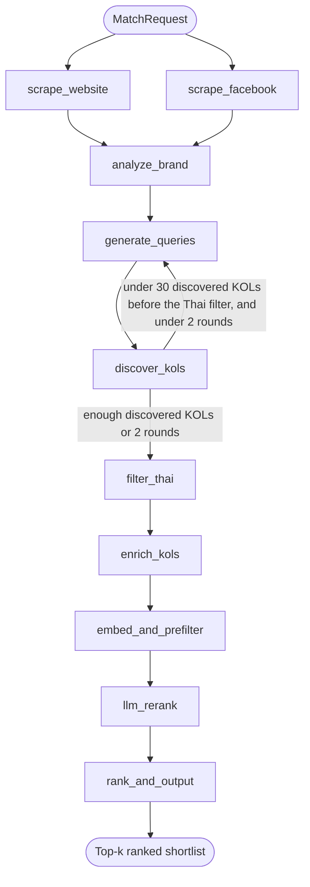
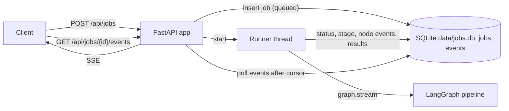

# TikTok KOL Matcher

A LangGraph pipeline that turns a brand's website and Facebook page into a ranked
shortlist of Thai TikTok creators. It runs as a CLI or as an HTTP service.

Given a brand website and Facebook page, it scrapes the sources, builds a
structured brand profile, generates TikTok search queries, discovers creators,
keeps Thai creators, enriches their profiles, and scores the shortlist on:

| Signal | Weight |
| --- | --- |
| Relevance to the brand | 40% |
| Engagement | 25% |
| Audience fit | 20% |
| Follower tier | 15% |

Each result includes the component scores, a total score, and a short reason for
the match.

## Architecture

### Pipeline

The graph in `backend/app/graph.py` runs these nodes:



The website and Facebook scrapers run in parallel, and `analyze_brand` waits
for both. Discovery loops back to query generation until it has at least 30
KOLs or reaches the 2-round cap. The 30-KOL target counts discovered (deduped)
KOLs before the Thai filter, so `filter_thai` runs after the target is met and
can shrink the list. A fatal node failure sets `stage` to `failed` and ends the
graph. A scraper failure is only a warning.

### HTTP service



`POST /api/jobs` stores the job as `queued`, starts a daemon thread, and
returns the job id. The thread moves the job to `running`, streams the graph,
and writes a `started` and a `finished` or `failed` event for every node. It
ends the job as `succeeded` or `failed` and writes a final `done` or `failed`
event. The SSE endpoint polls SQLite for events after the client's cursor, so a
replay and a live stream use the same code. On startup, jobs that a previous
process left `queued` or `running` are marked `failed` with
"interrupted by restart".

## Current status

Every external service in `backend/app/integrations/` has a `Protocol` and a
`Mock` implementation, so the whole pipeline runs offline and produces stable
output. Five pieces can run live:

| CLI flag | API flag | What runs live | Needs |
| --- | --- | --- | --- |
| `--live-web` | `live_web` | Brand website reading | nothing (`JINA_API_KEY` optional) |
| `--live-fb` | `live_fb` | Facebook page and recent posts | `APIFY_TOKEN` |
| `--live-kols` | `live_kols` | TikTok creator search and enrichment | `APIFY_TOKEN` |
| `--live-llm` | `live_llm` | Brand analysis, query generation, rerank | `LLM_API_KEY`, `NVIDIA_API_KEY`, or `OPENAI_API_KEY` |
| `--live-embed` | `live_embed` | Embeddings and the cosine prefilter | the `embed` extra (`uv sync --extra embed`) |

[Live integrations](#live-integrations) describes each one.

## Tech stack

- Python 3.13
- [uv](https://docs.astral.sh/uv/) for dependency management
- [LangGraph](https://langchain-ai.github.io/langgraph/) for orchestration
- Pydantic for domain models and structured outputs, pydantic-settings for
  service configuration
- FastAPI for the HTTP API, with SQLite job storage and server-sent events

## How to run

Install the dependencies first:

```bash
cd backend
uv sync
```

### CLI

The CLI runs one match in the foreground. With no `--live-*` flag every service
is mocked and nothing touches the network:

```bash
uv run python -m app.cli match \
  --website https://example-brand.co.th \
  --facebook https://www.facebook.com/example-brand \
  --top-k 10
```

Progress goes to stderr and the ranked table goes to stdout:

```text
[ 1] scrape_facebook    facebook=ExampleBrand
[ 2] scrape_website     website=1330 chars
[ 3] analyze_brand      brand=profile
[ 4] generate_queries   queries+8
[ 5] discover_kols      round=1 discovered=22 (+22 new)
...
rank  handle                     followers    ER % relevance engagement audience tier    total  reason
------------------------------------------------------------------------------------------------------------------------------------
   1  BankZaGaming               1,250,000   9.10%      0.21       0.61     1.00 mega    0.588  Embedding similarity 0.21. Tier: mega; audience...
```

`--json` prints the same run as one JSON object on stdout. Tune discovery with
`--min-candidates N` and `--max-rounds N`.

Add any `--live-*` flag from the table in [Current status](#current-status) to
run that service live. The flags combine. For example, this run reads the
website, the Facebook page, and TikTok live, and keeps the LLM and embeddings
on the mocks:

```bash
export APIFY_TOKEN=...
uv run python -m app.cli match \
  --website https://example-brand.co.th \
  --facebook https://www.facebook.com/example-brand \
  --top-k 5 \
  --live-web --live-fb --live-kols --max-enrich 5
```

If `--live-fb` or `--live-kols` is set without `APIFY_TOKEN`, the CLI exits
with code 2 before the pipeline starts.

### HTTP API on your machine

```bash
cd backend
uv run uvicorn app.api.main:app --port 8000
```

The service reads its configuration from the environment when it starts. It
does not read `.env` itself, so export the variables or use Docker Compose.
Jobs go to `data/jobs.db` relative to the working directory, so run it from
`backend/` or set `JOBS_DB`. [HTTP API](#http-api) lists the endpoints.

The API has no authentication and is meant for local use. Anyone who can reach
the port can start jobs, which spend Apify and LLM credit in live mode. Keep it
on localhost (uvicorn's default) or put it behind something that authenticates.

### Docker Compose

From the repository root:

```bash
cp .env.example .env   # optional: fill in keys for live mode
docker compose up --build
```

The `backend` service listens on `127.0.0.1:8000` only, since the API has no
authentication. Compose loads `.env` when it exists
and runs in demo mode without it. The caches and `jobs.db` live in the
`backend-data` volume, mounted at `/app/data`. The container runs as a non-root
user, and a health check calls `/api/health`. A commented-out `frontend` service
in `docker-compose.yml` is a placeholder for a Vite dev server on port 5173.

The image installs the default dependencies only. To bake in the local
embedder, build with the `embed` extra (this downloads the CPU build of torch):

```bash
docker build --build-arg INSTALL_EMBED=true -t tkm-backend backend
```

### Tests

```bash
cd backend
uv run pytest
```

The tests make no network calls.

## Configuration

### Demo and live mode

The HTTP service runs in one of two modes. `GET /api/health` reports the mode.

- **Demo mode** forces every flag off, so jobs run from the mocks and fixtures
  with no keys. A request that asks for a live flag still runs mocked. The
  service is in demo mode when `DEMO_MODE` is true, or when `DEMO_MODE` is
  unset and `APIFY_TOKEN` is missing.
- **Live mode** applies when `DEMO_MODE` is false, or when `DEMO_MODE` is unset
  and `APIFY_TOKEN` is set. A flag the request omits turns on when it can run:
  web always, Facebook and KOLs with `APIFY_TOKEN`, the LLM with an LLM key,
  and embeddings when the `embed` extra is installed. A flag set to `true` that
  cannot run returns 400 and names the missing variable, for example
  `live_kols is unavailable: APIFY_TOKEN is not set`. A flag set to `false`
  stays off.

The job records the flags it ran with in `flags`. The CLI has no mode. It runs
live only the services you name with `--live-*` flags.

### Environment variables

[`.env.example`](.env.example) lists every variable the code reads, with a
one-line description each. Blank values take the defaults. The main ones:

| Variable | Used by | Default |
| --- | --- | --- |
| `DEMO_MODE` | API mode | unset: demo unless `APIFY_TOKEN` is set |
| `APIFY_TOKEN` | live Facebook, TikTok search, enrichment | unset |
| `JINA_API_KEY` | live web reader | unset (requests go without a key) |
| `LLM_BASE_URL` | live LLM | `https://integrate.api.nvidia.com/v1` |
| `LLM_MODEL` | live LLM | `nvidia/nemotron-3.5-lightning-30b-a3b` |
| `LLM_API_KEY`, `NVIDIA_API_KEY`, `OPENAI_API_KEY` | live LLM, first non-empty wins | unset |
| `EMBED_MODEL` | live embedder | `google/embeddinggemma-2` |
| `KOL_CACHE_DIR` | every live cache | `data/cache` at the repo root |
| `JOBS_DB` | API job store | `data/jobs.db` |
| `CORS_ORIGINS` | API, comma-separated | `http://localhost:5173` |
| `JOB_WORKERS` | API, jobs that run at once | `2` |
| `MAX_QUEUED_JOBS` | API, jobs queued or running before `POST /api/jobs` returns 429 | `20` |

[LLM](#llm) and [Embeddings](#embeddings) list the tuning variables for those
integrations. Keys and tokens are never logged. `/api/health` reports each one
only as set or missing.

## HTTP API

| Method and path | Result |
| --- | --- |
| `POST /api/jobs` | 202 `{"job_id": "..."}`. 400 when a requested live flag cannot run. 422 on an invalid body, a `facebook_url` outside facebook.com or fb.com, or a `website_url` on a local or private address. 429 when `MAX_QUEUED_JOBS` jobs are queued or running |
| `GET /api/jobs/{id}` | Status, stage, request, effective flags, errors, and ranked results. 404 when unknown |
| `GET /api/jobs/{id}/events` | Server-sent events, ending with a `done` or `failed` event. 404 when unknown |
| `GET /api/jobs?limit=20` | Recent jobs, newest first. `limit` is 1 to 100 |
| `GET /api/health` | Mode, default flags, the configured models, and which credentials are set |

The examples below come from a local run in demo mode, trimmed.

### Create a job

`top_k` is 1 to 200 and defaults to 10. The live flags are optional. An omitted
flag takes the mode's default.

```bash
curl -X POST localhost:8000/api/jobs -H 'content-type: application/json' -d '{
  "website_url": "https://example-brand.co.th",
  "facebook_url": "https://www.facebook.com/example-brand",
  "top_k": 3
}'
```

```json
{"job_id":"14aa56a39f8845cab15a866b34308480"}
```

### Read a job

A job moves from `queued` to `running` to `succeeded` or `failed`.

```bash
curl localhost:8000/api/jobs/14aa56a39f8845cab15a866b34308480
```

```json
{
  "id": "14aa56a39f8845cab15a866b34308480",
  "status": "succeeded",
  "stage": "done",
  "request": {
    "website_url": "https://example-brand.co.th/",
    "facebook_url": "https://www.facebook.com/example-brand",
    "top_k": 3,
    "weights": {"relevance": 0.4, "engagement": 0.25, "audience": 0.2, "tier": 0.15}
  },
  "flags": {"live_web": false, "live_fb": false, "live_kols": false, "live_llm": false, "live_embed": false},
  "errors": [],
  "results": [
    {
      "kol": {
        "handle": "BankZaGaming",
        "url": "https://www.tiktok.com/@BankZaGaming",
        "followers": 1250000,
        "language": "th",
        "region": "TH",
        "median_engagement_rate": 0.091,
        "posts_per_week": 1.1,
        "content_summary": "Topics: gaming, esports",
        "source": "apify"
      },
      "scores": {
        "relevance": 0.2145,
        "engagement": 0.6067,
        "audience_fit": 1.0,
        "tier_fit": 1.0,
        "audience_confidence": "high"
      },
      "total_score": 0.5875,
      "reason": "Embedding similarity 0.21. Tier: mega; audience fit: high."
    }
  ],
  "created_at": "2026-10-27T06:17:33.008856+00:00",
  "updated_at": "2026-10-27T06:17:33.057882+00:00"
}
```

### Stream progress

```bash
curl -N localhost:8000/api/jobs/14aa56a39f8845cab15a866b34308480/events
```

Each event carries its sequence number as the SSE `id`. Node events have type
`node`, and the last event is `done` or `failed`, after which the server closes
the stream. A `finished` event carries a short summary such as `discovered+22`.

```text
event: node
data: {"job_id":"14aa56a39f8845cab15a866b34308480","seq":1,"type":"node","node":"scrape_facebook","status":"started","summary":"","timestamp":"2026-10-27T06:17:33.020539+00:00"}
id: 1

event: node
data: {"job_id":"14aa56a39f8845cab15a866b34308480","seq":3,"type":"node","node":"scrape_facebook","status":"finished","summary":"facebook=ExampleBrand","timestamp":"2026-10-27T06:17:33.024247+00:00"}
id: 3

event: node
data: {"job_id":"14aa56a39f8845cab15a866b34308480","seq":10,"type":"node","node":"discover_kols","status":"finished","summary":"round=1 discovered+22","timestamp":"2026-10-27T06:17:33.034594+00:00"}
id: 10

event: done
data: {"job_id":"14aa56a39f8845cab15a866b34308480","seq":25,"type":"done","node":null,"status":null,"summary":"ranked 3 KOLs","timestamp":"2026-10-27T06:17:33.057947+00:00"}
id: 25
```

To resume after a dropped connection, send the last `id` you received as
`Last-Event-ID` (an `EventSource` does this on its own) or pass `?after=N`. The
stream then starts after that event:

```bash
curl -N -H 'Last-Event-ID: 22' localhost:8000/api/jobs/14aa56a39f8845cab15a866b34308480/events
```

```text
event: node
data: {"job_id":"14aa56a39f8845cab15a866b34308480","seq":23,"type":"node","node":"rank_and_output","status":"started","summary":"","timestamp":"2026-10-27T06:17:33.055289+00:00"}
id: 23

event: node
data: {"job_id":"14aa56a39f8845cab15a866b34308480","seq":24,"type":"node","node":"rank_and_output","status":"finished","summary":"results=3","timestamp":"2026-10-27T06:17:33.056399+00:00"}
id: 24

event: done
data: {"job_id":"14aa56a39f8845cab15a866b34308480","seq":25,"type":"done","node":null,"status":null,"summary":"ranked 3 KOLs","timestamp":"2026-10-27T06:17:33.057947+00:00"}
id: 25
```

### List jobs

```bash
curl 'localhost:8000/api/jobs?limit=5'
```

The response is a JSON array of jobs in the same shape as `GET /api/jobs/{id}`,
newest first.

### Check health

```bash
curl localhost:8000/api/health
```

```json
{
  "status": "ok",
  "mode": "demo",
  "defaults": {"live_web": false, "live_fb": false, "live_kols": false, "live_llm": false, "live_embed": false},
  "credentials": {
    "APIFY_TOKEN": false,
    "LLM_API_KEY": false,
    "NVIDIA_API_KEY": false,
    "OPENAI_API_KEY": false,
    "JINA_API_KEY": false
  },
  "models": {
    "llm_model": "nvidia/nemotron-3.5-lightning-30b-a3b",
    "llm_host": "integrate.api.nvidia.com",
    "embed_model": "google/embeddinggemma-2"
  }
}
```

`defaults` are the flags an omitted request field takes. `models` shows what
the live LLM and embedder would use. `llm_host` is the host of `LLM_BASE_URL`
only, never the full URL.

## Live integrations

Each section below covers one `--live-*` flag. The API flag of the same name
runs the same code.

### Web reading

The default run uses the offline website fixture and does not touch the network.
`--live-web` fetches the brand site for real and leaves Facebook, TikTok search,
embeddings, and the LLM mocked:

- **Jina Reader** (`https://r.jina.ai/`) is the primary fetcher. Set `JINA_API_KEY`
  to send a bearer token and raise the rate limit. The key is not written to logs
  or error messages. Image links and empty bullets are stripped from its markdown.
- **trafilatura** is the fallback. It fetches the page directly when Jina errors
  or returns fewer than 200 characters. The request uses browser-like
  `Accept`, `Accept-Language`, and `Accept-Encoding` headers and HTTP/2, because
  some storefronts answer 200 to curl and 429 to a bare
  HTTP/1.1 client.
- Successful pages are cached as JSON under `data/cache/web` for 7 days. The cache
  key is the SHA-256 of the normalized URL. Set `KOL_CACHE_DIR` to move the cache
  root (`$KOL_CACHE_DIR/web`). A cache hit skips the network.
- Page text is cut to 20,000 characters before it enters graph state.

```bash
uv run python -m app.cli match \
  --website https://example-brand.co.th \
  --facebook https://www.facebook.com/example-brand \
  --top-k 5 \
  --live-web
```

### Facebook page (Apify)

The default run uses the offline Facebook fixture and does not call Apify.
`--live-fb` reads the page through Apify. It needs `APIFY_TOKEN`, handled the
same way as `--live-kols`: if the token is missing, the CLI exits with code 2
before the pipeline starts.

- **Profile** uses [apify/facebook-pages-scraper](https://apify.com/apify/facebook-pages-scraper)
  with `startUrls`. The page name, title, `intro`, `categories`, `followers`
  (or `likes` when followers is missing), website (`websites`, then the bare
  `website` domain), and `ad_status` are mapped onto the Facebook page.
- **Recent posts** use [apify/facebook-posts-scraper](https://apify.com/apify/facebook-posts-scraper)
  with `resultsLimit` 20. Up to 20 post texts are kept, each with its
  whitespace collapsed and cut to 1,000 characters. Brand analysis sees each
  post cut to 300 characters.
- **Cost controls.** Each page is two runs, and each run sets `maxItems`,
  `limit`, and `maxTotalChargeUsd` ($0.50). The store lists the page scraper
  from about $5–$12 per 1,000 pages and the posts scraper from about $2–$5 per
  1,000 posts.
- **Fallback.** When the profile run fails or returns no usable item, the page
  URL is read with the live web reader (Jina, then trafilatura, with its own
  cache), even without `--live-web`. The page name comes from the URL, the title
  from the first heading, and the intro from the page text. If that also
  fails, `scrape_facebook` records a warning and brand analysis runs on the
  website alone. When only the posts run fails, the page is kept with no posts.
- **Cache.** Complete Apify results are stored as JSON under
  `data/cache/facebook` for 7 days. The key is the SHA-256 of the normalized
  URL. Set `KOL_CACHE_DIR` to move the root (`$KOL_CACHE_DIR/facebook`). A hit
  does not call Apify. Fallback pages and pages without posts are not cached.
  A failed cache write keeps the fetched page.

```bash
export APIFY_TOKEN=...
uv run python -m app.cli match \
  --website https://example-brand.co.th \
  --facebook https://www.facebook.com/example-brand \
  --top-k 5 \
  --live-fb
```

### TikTok KOL search (Apify)

The default run uses the offline KOL fixtures and does not call Apify.
`--live-kols` searches TikTok and enriches Thai creators through Apify (at most
`--max-enrich`, default 10, largest accounts first, one paid run each).
Combine it with `--live-web` when both the site and the creator data should be live.

`APIFY_TOKEN` is read from the environment and sent only as an `Authorization`
header. It is not written to logs or error messages. If it is missing, the CLI
exits with code 2 before the pipeline starts.

- **Search** uses [clockworks/tiktok-scraper](https://apify.com/clockworks/tiktok-scraper).
  A query that is only a hashtag (a trailing "tiktok" is ignored, so
  `#examplebrand tiktok` counts) is sent as `hashtags`. Every other query is sent as
  `searchQueries` with `searchSection` set to `/video`, so each item is a video
  with `authorMeta`. Authors are deduped. Rows without a handle, and actor
  `errorCode` items, are skipped and recorded by `discover_kols`.
- **Enrichment** uses [clockworks/tiktok-profile-scraper](https://apify.com/clockworks/tiktok-profile-scraper)
  to fetch recent videos for one profile. The engagement rate for a video is
  `(likes + comments + shares) / views` (`diggCount`, `commentCount`,
  `shareCount`, `playCount`). When `playCount` is missing or zero, that video
  uses the same numerator divided by the profile's follower count. The stored
  value is the median of those rates, capped to the range 0–1.
  `posts_per_week` is `(n - 1) / weeks` between the oldest and newest non-pinned
  video in the sample. `content_summary` is a short line of captions and hashtags.
- **Cost controls.** `--max-results-per-query` (default 10) caps videos per
  search query and videos fetched per profile. `--max-enrich` (default 10)
  caps how many profiles are enriched. Video, cover, subtitle, and avatar
  downloads stay off, and comment scraping stays at zero. Each run sets
  `maxItems`, `limit`, and `maxTotalChargeUsd` (default $0.50) on the sync
  endpoint. Transport errors and HTTP 429/5xx are retried once. Timeouts and
  HTTP 408 are not retried, because the paid run may already be in progress.
  The store lists these actors from about $1–$2 per 1,000 results.
- **Cache.** Enrichment results are stored as JSON under `data/cache/apify` for
  7 days. Set `KOL_CACHE_DIR` to move the root (`$KOL_CACHE_DIR/apify`). A hit
  does not call Apify.

```bash
export APIFY_TOKEN=...
uv run python -m app.cli match \
  --website https://example-brand.co.th \
  --facebook https://www.facebook.com/example-brand \
  --top-k 5 \
  --live-kols \
  --max-results-per-query 5 \
  --max-enrich 10
```

`backend/scripts/apify_smoke.py` runs one search query with a maximum of 5
results and prints `handle`, `url`, and `followers`. It is the live check to
run once a token is available:

```bash
uv run python scripts/apify_smoke.py "รีวิวแว่นตา"
```

### LLM

The default run uses the offline brand analyzer and does not call a model.
`--live-llm` sends brand analysis, TikTok query generation, and relevance
reranking to an OpenAI-compatible chat completions API. Facebook scraping
stays mocked unless `--live-fb` is set. Embeddings stay on the offline mock unless `--live-embed` is
set. Combine the flag with `--live-web` and `--live-kols`
when those sources should be live too. Switching providers is configuration
only: set `LLM_BASE_URL`, `LLM_MODEL`, and a key.

| Variable | Default | Role |
| --- | --- | --- |
| `LLM_BASE_URL` | `https://integrate.api.nvidia.com/v1` | API root, including the `/v1` prefix |
| `LLM_MODEL` | `nvidia/nemotron-3.5-lightning-30b-a3b` | Chat model id |
| `LLM_API_KEY` | unset | Bearer token. If empty, `NVIDIA_API_KEY` is used, then `OPENAI_API_KEY` |
| `LLM_TIMEOUT` | `120` | Request timeout in seconds |
| `LLM_MAX_TOKENS` | `4096` | Completion token budget, shared with any reasoning trace |
| `LLM_TEMPERATURE` | `0.2` | Sampling temperature |
| `LLM_RERANK_BATCH_SIZE` | `5` | Creators scored per rerank request |
| `LLM_DISABLE_REASONING` | `extra_body` for the default endpoint and model, otherwise `off` | Provider-specific reasoning control, below |
| `LLM_NO_THINK_MESSAGE` | `/no_think` | System message used when reasoning control is `system` or `both` |

The default model is a reasoning model. A short prompt can take tens of seconds
and spend most of its completion tokens on `reasoning_content`. With a small
`max_tokens`, `content` comes back null. The client defaults are sized for
that: 4096 completion tokens and a 120 second timeout. Empty or missing
`content` is retried once.

`LLM_DISABLE_REASONING` picks how thinking is turned off. When it is unset, the
default NVIDIA endpoint and model use `extra_body` and every other provider
gets a plain request. The values are provider-specific:

- `off` sends a normal chat request.
- `system` prepends `LLM_NO_THINK_MESSAGE` (default `/no_think`). The default
  model ignores it, so it still thinks.
- `extra_body` sends `chat_template_kwargs.enable_thinking` set to false. On the
  default model this turns thinking off: a brand-analysis call dropped from
  about 30-45 seconds and 2,000-3,700 completion tokens to about 3 seconds and
  250 tokens.
- `both`, and also `true`, `1`, or `on`, does both.

A provider that rejects unknown JSON fields works with the default (`off` for
anything but the NVIDIA default). Point `LLM_BASE_URL` at
`https://api.openai.com/v1` and set `LLM_MODEL` plus `OPENAI_API_KEY` to use
OpenAI with no code change.

Each call asks for one JSON object. Code fences and leading prose are stripped,
the first JSON object is validated with Pydantic, and a validation failure is
retried once with the error in the next prompt. A second failure raises. The
graph records that on `errors`, sets `stage` to `failed`, and stops, the same
way other node failures do.

The model returns relevance from 0 to 1 and a short Thai or English reason.
Engagement, audience fit, and tier fit stay on the existing heuristics. The
total still uses the weights 0.4, 0.25, 0.2, and 0.15, with relevance as the
0.4 term. Query generation returns only the new queries for that round, so the
discovery loop and `last_queries` keep working. Rerank requests are batched.

The API key is not written to logs. It is stripped from error text.

```bash
export LLM_API_KEY=...
uv run python -m app.cli match \
  --website https://example-brand.co.th \
  --facebook https://www.facebook.com/example-brand \
  --top-k 5 \
  --live-llm
```

`backend/scripts/llm_smoke.py` runs one small brand-analysis call. It exits
with a message and code 2 when no key is set:

```bash
uv run python scripts/llm_smoke.py
```

### Embeddings

The default run uses an offline embedder. It does not download a model and it
does not touch the network. `--live-embed` loads `google/embeddinggemma-2`
with sentence-transformers, on CPU unless `EMBED_DEVICE` is set. The model is
loaded once per process and reused. Vision and audio towers are left unloaded
so only the text tower stays in memory.

The model is Apache 2.0. `HF_TOKEN` is optional.

Install the extra before a live run. It pulls sentence-transformers,
transformers, and the CPU build of torch. A plain `uv sync` does not install
them, so the default install and the tests stay offline.

```bash
cd backend
uv sync --extra embed
uv run python -m app.cli match \
  --website https://example-brand.co.th \
  --facebook https://www.facebook.com/example-brand \
  --top-k 5 \
  --live-embed
```

| Variable | Default | Role |
| --- | --- | --- |
| `EMBED_MODEL` | `google/embeddinggemma-2` | sentence-transformers model id |
| `EMBED_DEVICE` | `cpu` | device passed to the model |
| `EMBED_DIM` | `768` | Matryoshka size passed as `truncate_dim` (`768`, `512`, `256`, or `128`) |
| `EMBED_DTYPE` | `float32` | `float32` or `bfloat16` |
| `EMBED_BATCH_SIZE` | `32` | texts encoded per call |
| `PREFILTER_LIMIT` | `25` | candidates kept after cosine ranking, before rerank |
| `KOL_CACHE_DIR` | `data/cache` | cache root; embeddings are `$KOL_CACHE_DIR/embeddings` |
| `HF_TOKEN` | unset | optional download token |

The brand text (category, products, audience, keywords, hashtags) is the
query. Each creator (nickname, bio, caption summary, hashtags) is a document.
Queries use the `SearchQuery` prompt (`task: search result | query: `).
Documents use the `Document` prompt (`title: none | text: `). If those prompts
are not on the model, a document is formatted as
`title: {nickname or handle} | text: {content}`.

Similarity is cosine on L2-normalized vectors. `EMBED_DIM` truncates the
vector. The context window is 8192 tokens. Dtype is float32 or bfloat16, not
float16.

`--prefilter-limit` (or `PREFILTER_LIMIT`) sets how many creators go to the
reranker. The default is 25. If `--top-k` is larger, the width is raised to
`--top-k`, so a larger shortlist is not silently cut.

The offline reranker uses that cosine as the relevance score. The live
reranker still scores relevance itself and sees the cosine as
`embedding_similarity`. Engagement, audience fit, and tier fit are unchanged.
The total still uses the weights 0.4, 0.25, 0.2, and 0.15.

Vectors are cached as JSON under `data/cache/embeddings`. The file name is the
SHA-256 of the model, the prompt prefix, the text, and the dimension. Writes
are atomic. A cache hit does not call the model.

`backend/scripts/embed_smoke.py` embeds one query and two short documents:

```bash
uv run python scripts/embed_smoke.py
```

## Repo layout

```text
backend/
  app/
    graph.py         # graph wiring, parallel fan-in, discovery loop
    nodes.py         # the ten pipeline nodes
    models.py        # MatchRequest, BrandProfile, KolProfile, RankedKol, ...
    state.py         # MatchState and list reducers
    cli.py           # argparse CLI (table or JSON)
    api/             # FastAPI app: settings, SQLite job store, graph runner, routes
    prompts.py       # LLM prompt text for brand analysis, queries, and rerank
    integrations/    # Protocol + Mock per service; live web, Facebook, Apify, LLM, and embedder
    fixtures/        # mock website, Facebook page, KOL records, Apify samples
  scripts/           # apify_smoke.py, llm_smoke.py, and embed_smoke.py
  tests/
  Dockerfile
  pyproject.toml
docker-compose.yml
.env.example
README.md
```
